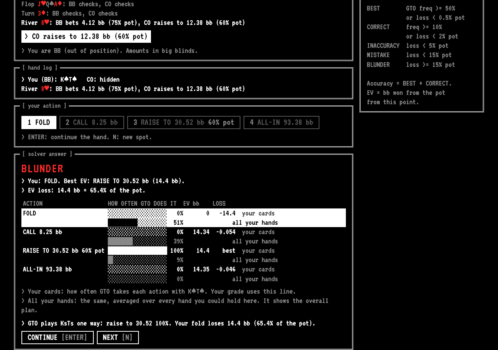
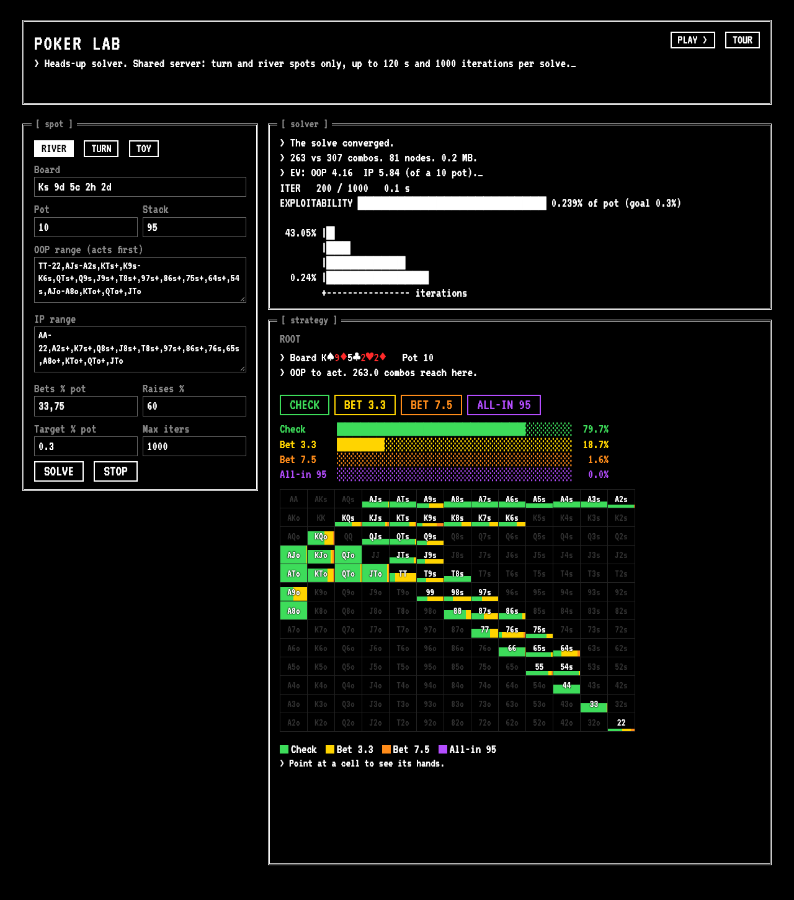
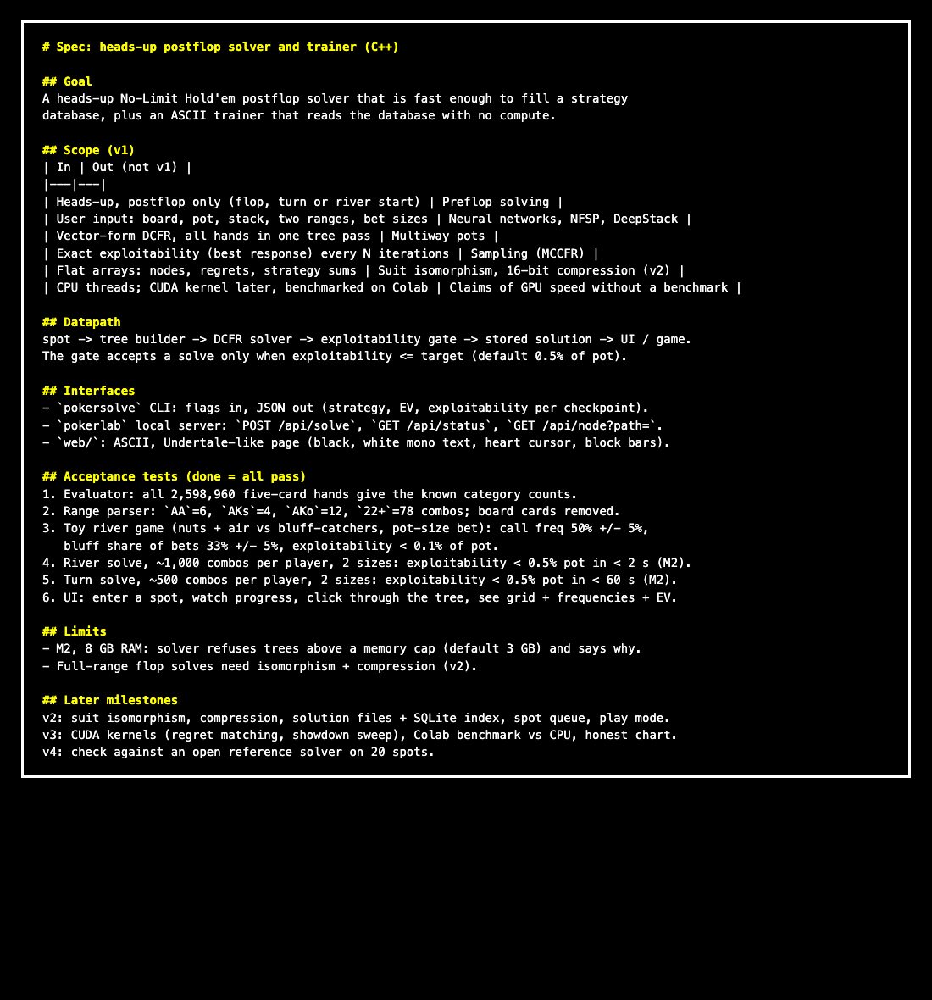

# pokercfrgpu

A heads-up No-Limit Hold'em postflop solver written from scratch in C++, and a web trainer
that grades your decisions against its answers.
It uses vector-form Discounted CFR: one tree pass handles every hand of both players.

**Live demo: [pokerlab.duckdns.org](https://pokerlab.duckdns.org)**

- [Trainer](https://pokerlab.duckdns.org/play): you get a real spot, choose an action, and get a grade
  at once against near-optimal play. Then the hand plays out to showdown against the solver strategy.
- [Solver](https://pokerlab.duckdns.org/): enter a board, two ranges and bet sizes, and solve it live
  (turn and river on the shared server; solves wait in line).

| Trainer | Solver |
|---|---|
|  |  |

**In numbers** (measured; details in the sections below):

- 467,027 stored decision spots from 15,041 accepted solves (river, turn, and 70 flops); every one
  passed a quality gate of at most 0.3% (river) or 0.5% (turn, flop) of the pot in exploitability.
- Strategies agree with the open-source TexasSolver within 0.4 percentage points.
- On the same river and turn spots, the CPU solver reaches the same quality 1.7-2.0x faster than
  TexasSolver on the same laptop (8 threads, median of 3 runs; [docs/benchmark-texassolver.md](docs/benchmark-texassolver.md)).
- River solve 0.11 s and turn solve about 12 s on average on an Apple M2 laptop.
- The next practice question loads in about 3 ms (was 20 s before an indexed random pick).
- The demo runs on one free Oracle Cloud core behind nginx with https.
- A CUDA version of the solver is 5.4x (turn) to 11.5x (flop) faster on a Tesla T4 GPU than the
  CPU solver on the M2, at the same exploitability ([docs/gpu.md](docs/gpu.md)).
- A neural-network value function (DeepStack/ReBeL style) cuts the error of a depth-limited flop
  solve from about 24% to about 4% of the pot ([docs/value-net.md](docs/value-net.md)).



## Run

```bash
cmake -S . -B build && cmake --build build -j8
./build/tests            # acceptance tests (about 10 s)
./build/pokerlab 8080    # then open http://127.0.0.1:8080 (a guided tour starts on the first visit; press TOUR to replay)
```

Command line:

```bash
./build/pokersolve --board "Ks 9d 5c 2h 2d" --pot 10 --stack 95 \
  --oop "TT-22,AJs-A2s,KTs+,QTs+,AJo-A8o" --ip "AA-22,A2s+,K7s+,A8o+,KTo+" \
  --bets 33,75 --raises 60 --target 0.3
```

Size keys: `bets`, `raises`, and overrides such as `ip_bets`, `river_bets`,
`oop_turn_raises`. The value `none` removes all sizes.

## How it works

1. **Tree builder** (`src/game.cpp`): betting nodes, fold/showdown leaves, and chance
   nodes for each turn and river card. All nodes sit in one flat array.
2. **DCFR** (`Game::walk`): the traverser gets a value vector per hand; the opponent
   passes a reach vector per hand. Regrets update with discounts alpha = 1.5, beta = 0,
   gamma = 2.
3. **Showdown in O(n)**: hands are sorted by strength once per river board. One sweep up
   and one sweep down give each hand its win and loss totals. Per-card sums remove
   hands that share a card (blockers).
4. **Exploitability**: an exact best response for each player. A solve stops when
   exploitability is below the target (default 0.5% of the pot).

## Measured (Apple M2, 8 threads)

| Spot | Combos (OOP / IP) | Result |
|---|---|---|
| River, 2 bet sizes | 1,081 / 1,081 | 0.38% of pot in 0.28 s |
| Turn, 2 bet sizes | 458 / 458 | 0.37% of pot in 17 s |
| Flop, 1 bet size, 1 raise | 270 / 314 | 0.51% of pot in 7 min, 2.4 GB |
| Flop, 2 bet sizes | 270 / 314 | refused: needs 12.4 GB |

## Tests (`tests/tests.cpp`)

- Evaluator: all 2,598,960 five-card hands give the known category counts.
- Ranges: combo counts for `AA`, `AKs`, `22+`, `A5s-A2s`, weights, errors.
- Terminal math: the fast sweep equals a slow pairwise loop (error about 1e-7).
- Toy river game: call frequency 0.500 and bluff share 0.333, as theory predicts.
- Speed: river under 2 s, turn under 60 s, both under 0.5% of pot.

## Status and next steps

Done: suit isomorphism, 16-bit regret compression, a SQLite solution store
([docs/STORE.md](docs/STORE.md)), batch training (`pokerbatch`), a free flop screen
(`pokerscreen`), the trainer (`/play`), and a public solver mode (`pokerlab --public`).

Also done: 70 of 74 picked flops solved (4 rejected), early stop for stuck flop solves, a CUDA
solver ([docs/gpu.md](docs/gpu.md)), and depth-limited flop solving with a value network
([docs/value-net.md](docs/value-net.md)). The value network does not reach the 0.5% gate, so
stored answers come from full DCFR.

Next: test the trainer with real players. See [SPEC.md](SPEC.md). The old Python prototype is kept at tag `python-prototype`.
