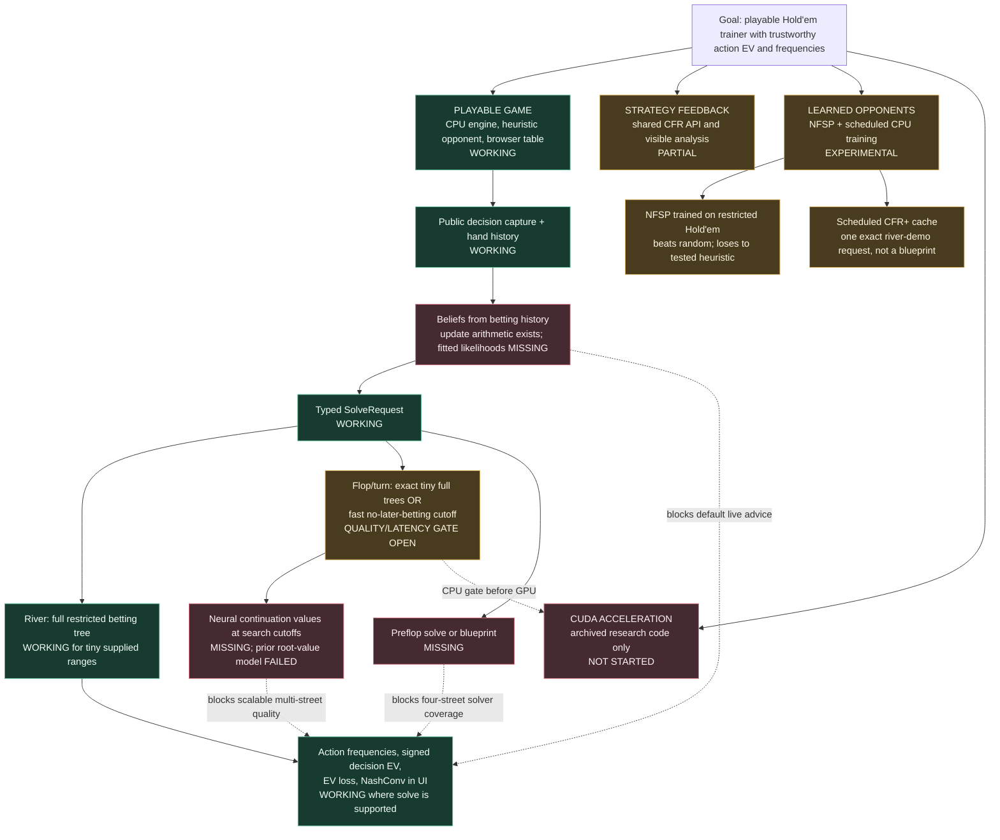
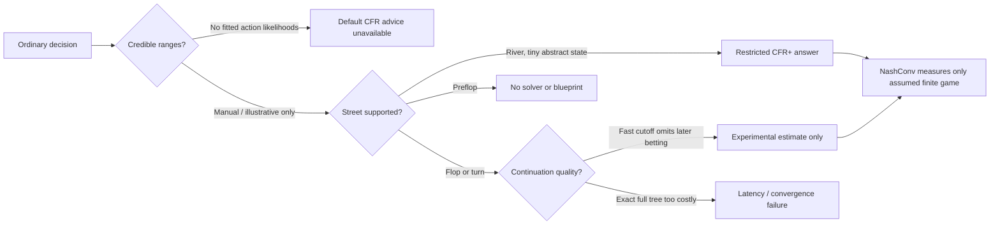

# Where the poker trainer stands

**Audit date:** 2026-10-15. **Revision:** `af3f864` plus uncommitted workspace changes. This is a snapshot of code, tests, and saved experiments, not a claim that all features are release-ready. The key distinction is between a playable game, a mathematically defined *restricted* solve, and dependable advice for ordinary hands.

## The whole project at a glance

**Reading the diagram:** the green display box means the UI renders *real solver outputs* for supported explicit-range positions. It does **not** mean its assumed opponent range describes the player in an ordinary hand. Low NashConv certifies only the game represented by that solve. The yellow flop/turn cutoff removes later betting, so its low NashConv is not evidence of accurate full-hand EV.

## Component inventory

| Part | Technology and code | Current evidence | Limitation / next gate |
|---|---|---|---|
| Rules and cards | Python `poker_cpu/engine.py`, `cards.py`; seeded tests and independent Treys cross-check | Full local game works; 5,000 saved evaluator comparisons had zero disagreements; current Python suite passed 106 tests at this audit | Exhaustive betting-tree proof is absent, but this is **not the main blocker** to solver work. |
| Game and product UI | Python HTTP server; vanilla HTML/CSS/JS in `trainer/static/` | Chrome test played a real hand, reopened the table after a demo, and checked real analysis values against HTTP responses | Ordinary play is functional. Most decisions still cannot receive validated automatic CFR advice. |
| Public state → request | `request_from_game()` in `poker_cpu/solve.py`; `TableSession` snapshots in `trainer/server.py` | A four-street seeded trace captured board, pot, stacks, history, and hero hand without opponent hole cards | Default live requests deliberately have `ranges=None`; custom wagers may not fit the solve abstraction. |
| Range editor and inference | 13×13 UI in `ranges.js`; weighted combos/blockers in `ranges.py`; Bayesian event replay in `range_inference.py` | Manual multi-class/suit-specific selection works; update arithmetic has tests | Presets are illustrative. There is **no fitted, held-out-calibrated action-likelihood provider**, so an automatic posterior is not credible. |
| Shared solver API | `SolveRequest`/`SolveResult` in `poker_cpu/solve.py`; CFR/CFR+/DCFR in `river_solver.py`; postflop tree in `multi_street.py` | Shared river path matched the preserved reference on a four-deal fixture; conditional root action EVs were independently enumerated to <1e-10 chip difference | Exact best response and NashConv apply to the **finite supplied-range action tree**, not full Hold'em. |
| River Solver Lab and one-click demo | `/api/solve`, `/api/demo-analysis`; exact-request cache in `solution_cache.py` | Demo: four compatible joint deals, 2,000 CFR+ iterations, 0.080251-chip restricted NashConv; browser displays actual frequencies and action EVs | Tiny explicit ranges; one cached request. Broad ranges and arbitrary histories have no demonstrated quality/latency. |
| Flop and turn | Exact chance/future betting in `multi_street.py`; one-street exact-runout cutoff in `one_street_solver.py` | Full tiny turn and flop reference cases run; opt-in saved-hand cutoff review works | At 98-chip stacks, one full turn iteration took 13.45 s with 43.59-chip NashConv. The faster cutoff assumes **no future betting** and has not passed downstream root-action EV/regret comparison. |
| Preflop analysis | No full-hand preflop solver or validated blueprint | `solve()` explicitly returns unsupported before creating a game | Need blind/BB-option state, action/chance abstraction, and engine-payoff parity tests before any preflop EV/frequency claim. |
| Value network / DeepStack-style cutoff | PyTorch research experiments under `experiments/river_value*` | Prior model's held-out root-value MAE was 2.07–2.35 chips; shallow CFR achieved 0.96 chips on that dataset | That model predicts **root values**, not cutoff counterfactual-value vectors; there is no validated neural continuation evaluator or safe re-solving guarantee. |
| NFSP opponent | PyTorch DQN plus supervised average policy and replay/reservoir in `poker_cpu/nfsp.py` | Three restricted-Hold'em training seeds were profitable vs random (+0.86 to +1.48 chips/hand) | They lost to the tested heuristic (−1.04 to −2.08 chips/hand); NFSP is separate from CFR and does not unblock solver accuracy. |
| Offline work and dashboard | Separate CPU worker/checkpoints in `trainer/offline_training.py`; status/curves in browser | Start/stop, persistence, browser polling, and conservative candidate gates passed smoke tests | No stronger NFSP model or broad CFR blueprint was demonstrated as promoted; the river cache covers one request. Dashboard curves are real run data, not strength proof. |
| CUDA | Archived `cuda_experiments/` | Apple arm64; PyTorch 2.10 reports `cuda=False`; `nvcc` absent | CPU quality gates are open and no compatible NVIDIA GPU is present. No CUDA numerical or speed result may be claimed. |

The workspace also contains an **uncommitted heuristic Monte Carlo rollout prototype** (`poker_cpu/rollout_feedback.py`) and a `/api/live-estimate` route. It samples hidden cards and plays out actions against heuristic policies; a small deterministic test exists. It is not CFR, not a GTO estimate, and at this audit it is not a validated substitute for the missing four-street solver. A separate opt-in browser control now displays these sampled heuristic-continuation EVs; it remains outside the CFR feedback path and is hidden during the three playable Solver Demo hands. Keep its results separate from solver-derived feedback.

## What happens on each street today

| Street | Normal Play & Learn request | Opt-in / lab path | Why this is not general live advice |
|---|---|---|---|
| Preflop | Explicitly unsupported | No CFR solve or blueprint | Missing preflop betting/chance model and validated ranges. |
| Flop | Default CFR feedback unsupported | Saved-hand review solves **current-street betting + exact showdown runouts**, with no later betting; research full tree is severely capped | Fast cutoff changes the game; full tree is too slow and narrow. |
| Turn | Default CFR feedback unsupported | Same no-later-betting cutoff; tiny exact turn→river research solves exist | At realistic stacks, exact traversal is far beyond interactive time; cutoff decision error versus deeper play is unmeasured. |
| River | Default CFR feedback unsupported | Manual-range Solver Lab and opt-in assumed-range review use the real restricted CFR+ betting tree | No calibrated betting-history ranges; only abstract action histories and tiny range sizes are supported. |

The relevant code-level trace and raw inputs are in [LIVE_SOLVER_DIAGNOSIS.md](LIVE_SOLVER_DIAGNOSIS.md) and [live_pipeline_diagnosis.json](../experiments/live_pipeline_diagnosis.json). A single hand is a wiring diagnostic, not a population-quality evaluation.

## Why the project cannot claim the intended final product yet

These are **release and claim blockers, not reasons to stop development**. The smallest honest fix for default river feedback is to provide explicit, labeled assumed ranges as an opt-in mode; saved-hand review already does that. Making it *automatic and reliable* requires a fitted action-likelihood model and held-out posterior/range-sensitivity evaluation. The smallest honest fix for earlier-street experimental feedback is the present no-later-betting cutoff; making it useful as full-game advice requires a validated continuation approximation. Preflop needs its own game model or tested blueprint. CUDA cannot solve any of these modeling errors.

## Evidence that sets the boundary

| Saved experiment | Observation | Interpretation |
|---|---|---|
| [River demo baseline](../experiments/demo_analysis_baseline.json) | 0.080251-chip restricted NashConv after 2,000 CFR+ iterations on four deals; one saved CPU solve took 3.689 s | A reproducible small river solve, not broad-range equilibrium. |
| [River range suite](../experiments/river_range_suite.json) | Five tiny boards/range pairs at 500 iterations ranged from 0.0056 to 0.2038 chips NashConv | One iteration budget is not a universal quality certificate. |
| [Live pipeline trace](../experiments/live_pipeline_diagnosis.json) | Full turn: one iteration in 13.45 s, 43.5924 chips NashConv; cutoff turn: 500 iterations in 0.467 s, 0.000218-chip **cutoff-game** NashConv | The faster solve uses a different continuation rule; it does not establish accurate full-game action EV. |
| [Three-board turn comparison](../experiments/turn_board_suite.json) | 100-iteration 4-deal turn solves took 5.5–5.8 s; max action-EV delta from 300-iteration profiles was 0.234463 chips | Narrow decision comparison; insufficient speed and coverage for default feedback. |
| [Neural diagnosis](../experiments/river_value_diagnosis.json) | Root-value model MAE 2.07–2.35 chips versus 0.96 for shallow CFR | Existing model cannot be used as a cutoff evaluator. |
| [Hold'em NFSP fixed evaluation](../experiments/holdem_nfsp_fixed_eval.json) | Three seeds beat random but lose chips to the fixed heuristic | Functional experimental opponent, not evidence of strategic strength. |

## The next dependency chain

1. **Freeze a validation suite.** Save varied board/range/history/stack/action states, fixed seeds and reference configurations. For each, record restricted NashConv, hand-conditional root action EV, selected-action regret against a deeper profile, range size, latency, and memory. The existing small fixtures are insufficiently varied.
2. **Validate beliefs separately.** Fit action likelihoods from data with known private cards or a controlled policy, split by player/session, and measure held-out log loss, calibration, posterior coverage, and how range errors change chosen actions. Until then, use manually entered or conspicuously assumed ranges only.
3. **Make turn/flop cutoffs strategically meaningful.** Generate nonterminal cutoff labels with deeper CPU solves; compare the no-later-betting baseline, neural value model, and deeper reference on held-out boards/ranges. Require lower root action-EV error and action regret at a useful end-to-end latency. [PROJECT_METRICS.md](PROJECT_METRICS.md) defines prospective value-network gates; none is achieved.
4. **Add preflop deliberately.** Implement a restricted blind-aware preflop tree or precomputed blueprint, with chance and payoff tests against the engine. Do not reuse postflop or NFSP frequencies as preflop CFR advice.
5. **Expand coverage only after each gate.** Support more histories, range combos, and legal bet sizes, then measure p50/p95 latency and quality across the suite. Keep unsupported states explicit. Evaluate NFSP and cache coverage as separate tracks; revisit CUDA only with a stable CPU reference and NVIDIA hardware.

**What can move forward now:** game polish, rigorous small-game solver validation, explicit-range river study, and controlled range/continuation experiments. **What cannot honestly be advertised yet:** automatic four-street GTO-style frequencies, calibrated real-opponent EV loss, DeepStack-equivalent solving, a stronger promoted blueprint, or GPU acceleration.

## Update — 2026-10-20

Scenario Lab now starts with familiar fields and a one-click river path; range editing, street selection, stack asymmetry, and solver budgets are in Advanced. `trainer/cfr_scenario_worker.py` can run low-priority, reproducible CFR+ jobs for random four-deal river games and stores only threshold-passing cases in its qualified cache directory. One seeded 1,000-iteration case measured 0.000288735-chip exact restricted NashConv in 2.2475 seconds and passed a 0.1-chip restricted-game screen. The first batch exposed and fixed a root-actor mismatch after four solves; the corrected worker restarted for approximately one hour with OS nice level 15, 15-second idle pauses, and a maximum of 250 solves. At the latest status it had ten completed and qualified scenarios; a separate corrected solve at seed 20261024 measured 0.171245 chips and remained candidate-only. Final pass rate is pending. Random cached roots are not connected to ordinary full-hand gameplay, because no preflop-to-river CFR strategy tree exists and random boards rarely match a live hand. See E049 in the experiment log and failure analysis for scope and evidence.

### Current session correction — 2026-10-20

The worker counts above are historical snapshots, not current process status. A process inspection for `cfr_scenario_worker` and `agent_workflow.cli` found neither running. The optional Agents SDK is not installed and `OPENAI_API_KEY` is absent, so the requested two-hour live manager/editor/reviewer run has **not** started; the two-hour dry-run only verified its ordered queue. The current uncommitted solver change adds separate per-street/per-action sizing and a Shark-inspired compact menu, with small legal-target tests. The ordinary default action tree and solver mathematics are unchanged. This code has not been benchmarked on broad ranges or cross-checked against Shark/GTO Wizard. For exact changes and tests see E056 in [EXPERIMENT_LOG.md](EXPERIMENT_LOG.md).

### Solver tree profiling update — 2026-10-20

The optional manager was subsequently invoked from the user's Terminal, but it exited before its first cycle with HTTP 401 and produced no code patch. Direct local work continued. E057 profiles six river sizing menus on one fixed tiny game and shows measured tree/latency growth; qualified exact-request cache entries are now consumed by Scenario Lab with source-fingerprint checks. E058 adds seven declared one-deal solver profiles across river, turn, and flop paths. Five meet ≤0.1-chip NashConv inside their own restricted games at the recorded budgets; full exact flop is capped at three iterations and sampled full flop still measures roughly 0.46–0.49 chips at 2,000 iterations. This does not mean the solver supports arbitrary scenarios: cutoff games omit later betting, full flop remains experimental, and preflop is unsupported. See the per-run records in `experiments/profile_sizing_trees.json`, `experiments/validate_tree_profiles.json`, and `experiments/tree_profile_convergence.json`.
